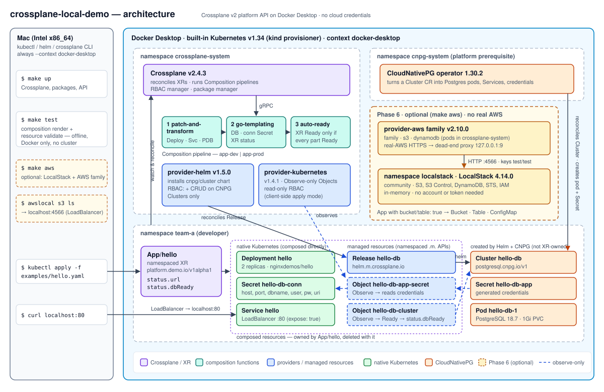
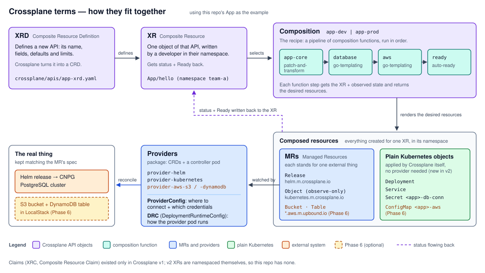
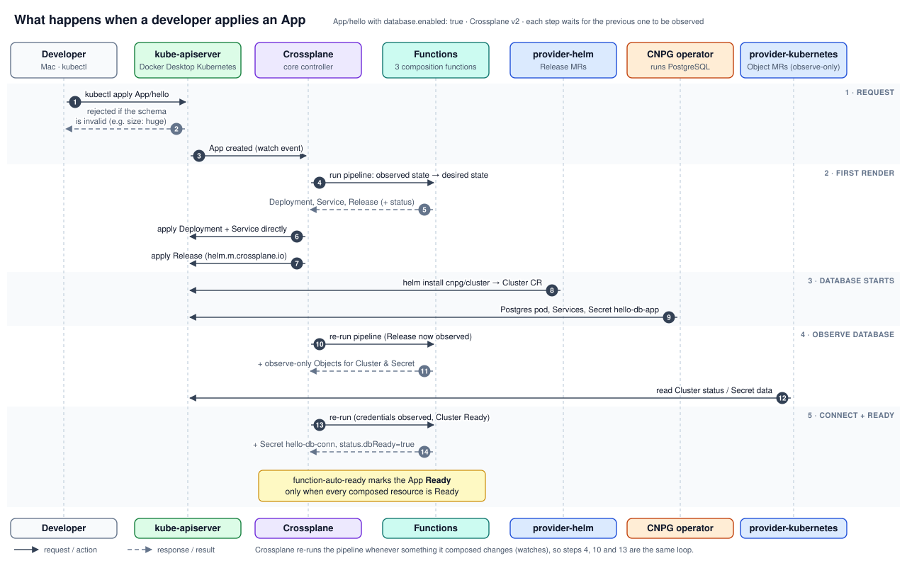

# Crossplane Local Demo

[](https://github.com/elveli/crossplane-local-demo/actions/workflows/ci.yml)

A self-contained **Crossplane v2** platform-engineering demo that runs entirely on
**Docker Desktop** (built for Intel Macs). It needs no cloud account and no credentials.
A developer creates one small `App` object, and the platform turns it into a
Deployment, a Service, a PostgreSQL database and a connection Secret. It then keeps
them in the declared state. An optional
[AWS flavour](#optional-aws-flavour-on-localstack-phase-6) adds an S3 bucket and a
DynamoDB table to the same API, using the provider-aws family against LocalStack. It
still needs no account.

It's the sequel to [Crossplane-AWS-Demo](https://github.com/elveli/Crossplane-AWS-Demo),
which used raw managed resources against real AWS (see
[Evolution from Crossplane-AWS-Demo](#evolution-from-crossplane-aws-demo)).



## Table of Contents

- [What Does This Demo Implement?](#what-does-this-demo-implement)
- [Crossplane Terms (Glossary)](#crossplane-terms-glossary)
  - [The core objects](#the-core-objects)
  - [Concepts you'll see in output](#concepts-youll-see-in-output)
- [Architecture](#architecture)
- [Repository Structure](#repository-structure)
- [Prerequisites](#prerequisites)
- [Quick Start (5 minutes)](#quick-start-5-minutes)
- [Makefile Command Reference](#makefile-command-reference)
- [The Demo, Scene by Scene](#the-demo-scene-by-scene)
- [How It Works](#how-it-works)
- [Optional: AWS Flavour on LocalStack (Phase 6)](#optional-aws-flavour-on-localstack-phase-6)
- [Offline Testing](#offline-testing)
- [Crossplane v1 → v2: What Changed](#crossplane-v1--v2-what-changed)
- [Evolution from Crossplane-AWS-Demo](#evolution-from-crossplane-aws-demo)
- [Troubleshooting](#troubleshooting)
- [Cleanup](#cleanup)
- [Pinned Versions](#pinned-versions)
- [Quick Reference Cheat Sheet](#quick-reference-cheat-sheet)

## What Does This Demo Implement?

The demo adds a new kind of Kubernetes object called **`App`**. A developer describes
what they want in a few lines, in the same way they would write a Deployment, and
the platform does the rest:

```yaml
apiVersion: platform.demo.io/v1alpha1
kind: App
metadata: { name: hello, namespace: team-a }
spec:
  image: nginxdemos/hello:plain-text
  replicas: 2
  port: 80
  database: { enabled: true, size: small }   # small|medium
  expose: true
```

- **New kind:** `App` isn't built into Kubernetes. The platform team defines it, and
  that is what "platform API" means. Developers get a small, safe interface (an
  image, a replica count, "I need a database") instead of writing Deployments, Helm
  releases and Secrets themselves.
- **`apiVersion: platform.demo.io/v1alpha1`:** the API group and version this
  repo gives `App`, the same way a Deployment uses `apps/v1`. `v1alpha1` means
  the API is still early and may change.
- **Namespaced:** an App lives in the team's own namespace (`team-a` here), like a
  Deployment does. Teams see and manage only their own Apps, and everything an App
  creates lands in that namespace too. Crossplane v1 needed an extra "claim" object
  for this; v2 doesn't (see [Glossary](#crossplane-terms-glossary)).

From that one object, Crossplane builds and maintains:

| Resource | How it's created | Notes |
|---|---|---|
| `Deployment` + `Service` | composed **directly** (v2 can compose any Kubernetes kind) | `expose: true` gives a LoadBalancer at `http://localhost:<port>` |
| PostgreSQL 18.7 | **provider-helm** `Release` installs the CloudNativePG `cluster` chart | `size` sets CPU, memory and storage |
| `Secret <app>-db-conn` | composed from the database credentials, which **provider-kubernetes** reads with observe-only access | `host`, `port`, `dbname`, `username`, `password`, `uri` |
| `status.url`, `status.dbReady`, `status.availableReplicas`, `status.connectionSecret` | written back to the App by the Composition | `kubectl get app` shows them as columns |
| *optional:* S3 `Bucket`, DynamoDB `Table`, `ConfigMap <app>-aws` | `bucket: true` / `table: true`, via the **provider-aws family** against **LocalStack** (`make aws`) | see [Phase 6](#optional-aws-flavour-on-localstack-phase-6) |

There are two implementations of the same API: **`app-dev`** (the default) and
**`app-prod`** (2 Postgres instances, PodDisruptionBudgets, bigger requests). An App
chooses one with `spec.crossplane.compositionSelector`.

## Crossplane Terms (Glossary)

Crossplane uses many abbreviations, and the rest of this README uses them freely. In
short: an **XRD** defines a new API, an **XR** is one object of that API, a
**Composition** says what the XR turns into, and **Providers** reconcile the
resulting **MRs** against the outside world.



### The core objects

| Term | Stands for | What it is | In this repo |
|---|---|---|---|
| **CRD** | Custom Resource Definition | Plain Kubernetes: adds a new object type to the API server. Crossplane, its providers and XRDs all work by creating CRDs. | Created for you; `kubectl get crd \| grep crossplane` |
| **XRD** | Composite Resource Definition | Crossplane's way to define **your own API**: a name, an OpenAPI schema (fields, defaults, enums, bounds) and a scope. Crossplane creates the matching CRD from it. | [`crossplane/apis/app-xrd.yaml`](crossplane/apis/app-xrd.yaml) defines `App` (`platform.demo.io/v1alpha1`, `scope: Namespaced`) |
| **XR** | Composite Resource | One object of an XRD's API, i.e. what a developer actually creates. Crossplane composes resources for it and writes `status` back. | `App/hello` in namespace `team-a` ([`examples/hello.yaml`](examples/hello.yaml)) |
| **Composition** | — | The recipe that turns an XR into resources. An XRD can have several; the XR picks one (here via `spec.crossplane.compositionSelector`). | [`app-dev`](crossplane/compositions/app-dev.yaml) (default) and [`app-prod`](crossplane/compositions/app-prod.yaml) |
| **Function** | Composition Function | A small program, shipped as a package and run as a pod, that is one step of a Composition's **pipeline**. Each step gets the XR plus the observed state and returns the desired resources. | `function-patch-and-transform`, `function-go-templating`, `function-auto-ready` ([`functions.yaml`](crossplane/functions/functions.yaml)) |
| **Composed resource** | — | Anything a Composition creates for an XR. In v2 this can be **any** Kubernetes kind, not only MRs. Each carries the label `crossplane.io/composite=<xr-name>`. | Deployment, Service, Secret, ConfigMap, plus the MRs below |
| **MR** | Managed Resource | A Kubernetes object that stands for **one external thing** (a Helm release, a bucket, …). A provider keeps the external thing matching the MR's `spec` and reports back in `status`. In v2, MRs are namespaced (API groups with `.m.`). | `Release` (`helm.m.crossplane.io`), `Object` (`kubernetes.m.crossplane.io`), Phase 6: `Bucket`, `BucketVersioning`, `Table` (`*.aws.m.upbound.io`) |
| **Provider** | — | A package that installs the CRDs for a set of MRs plus the controller (a pod) that reconciles them. | `provider-helm`, `provider-kubernetes` ([`02-providers.yaml`](crossplane/providers/02-providers.yaml)); Phase 6: `provider-aws-s3`, `provider-aws-dynamodb` |
| **Provider family** | — | A large provider split into one package per service, plus a shared "family" package that owns the common config types. You install only the services you need instead of the whole monolith. | Phase 6: `provider-family-aws` + `-s3` + `-dynamodb` ([`aws/02-providers.yaml`](crossplane/providers/aws/02-providers.yaml)) |
| **ProviderConfig** / **ClusterProviderConfig** | — | Tells a provider **where to connect and how to authenticate**. `ProviderConfig` is namespaced, `ClusterProviderConfig` is cluster-wide. Every MR points at one with `providerConfigRef`. | `default` for helm/kubernetes ([`04-providerconfigs.yaml`](crossplane/providers/04-providerconfigs.yaml)); `localstack` for AWS ([`aws/03-providerconfig.yaml`](crossplane/providers/aws/03-providerconfig.yaml)) |
| **DRC** | DeploymentRuntimeConfig | Tunes **how a provider or function pod runs**: args, env, resources, service account. Replaces v1's `ControllerConfig`. | Laptop-sized requests ([`01-runtime-config.yaml`](crossplane/providers/01-runtime-config.yaml)); the AWS egress guard ([`aws/01-runtime-config.yaml`](crossplane/providers/aws/01-runtime-config.yaml)) |
| **Package** / **xpkg** | Crossplane package | The OCI image format for providers, functions and configurations. v2 has no default registry, so references are fully qualified. | `xpkg.crossplane.io/crossplane-contrib/provider-helm:v1.5.0` |
| **ProviderRevision** / **FunctionRevision** | — | One installed version of a package. Upgrading creates a new revision; the old one is deactivated. | `kubectl get providerrevisions` |
| **XRC** / Claim | Composite Resource Claim | **v1 only.** A namespaced proxy for a cluster-scoped XR. v2 XRs can be namespaced themselves, so this repo has no claims. | — (see [v1 → v2](#crossplane-v1--v2-what-changed)) |

### Concepts you'll see in output

| Term | Meaning | In this repo |
|---|---|---|
| **Pipeline mode** | The only Composition mode in v2: a list of function steps that run in order, each adding to the desired state. | 4 steps: `app-core`, `database`, `aws`, `ready`, see [The Compositions](#the-compositions-pipeline-mode) |
| **Observed / desired state** | *Observed*: what exists right now (the XR and its composed resources). *Desired*: what the functions say should exist. Crossplane applies the difference. | `make render` with `tests/fixtures/observed-db-ready.yaml` simulates observed state offline |
| **Reconcile** / **drift** | Crossplane and providers keep comparing desired and actual state and fix any difference (drift), whoever caused it. | Demo scene 3 scales and deletes the Deployment, Phase 6 scene 5 deletes the bucket; Crossplane reverts both |
| **`Synced` / `Ready`** | The two standard conditions. `Synced`: the last reconcile succeeded. `Ready`: the resource is actually usable (for an XR: all composed resources are Ready). | `kubectl get app` columns; `function-auto-ready` sets XR readiness |
| **`Responsive`** | v2 condition from the **watch circuit breaker**: if composed resources change too fast, Crossplane stops reacting to watch events for that XR for a while. | Demo scene 4, see [Watch circuit breaker](#watch-circuit-breaker-new-in-v2) |
| **Management policies** | Which operations a provider may perform on an MR. `["Observe"]` = read-only: import and report, never create, change or delete. | The CNPG `Cluster` and its Secret are read through observe-only `Object`s |
| **External name** | Annotation `crossplane.io/external-name`: the name of the external thing, if it differs from the MR's name. | Phase 6 buckets/tables are named `<namespace>-<app>` |
| **Trace** | `crossplane resource trace` shows an XR and the tree of everything composed from it, with each node's status. | `crossplane resource trace app/hello -n team-a --context docker-desktop` |

## Architecture

The diagram above shows the components. This sequence shows what happens when a
developer applies an App:



**Key points**

- **Everything is local.** Docker Desktop's built-in Kubernetes runs Crossplane,
  two providers, three functions and the CloudNativePG operator. Measured footprint
  with one App and its database: **about 414 MiB** (Crossplane and packages 297 MiB,
  CNPG operator 34 MiB, App with Postgres 83 MiB).
- **Native resources need no provider.** In v2, a Composition creates Deployments,
  Services and Secrets directly. Providers are used only where they add something:
  Helm for the database chart, and Kubernetes for reading objects the Composition
  doesn't own.
- **Database readiness is real.** `status.dbReady` comes from CNPG reporting the
  Cluster `Ready`, not from "the Helm install finished".
- **Every command passes `--context`**, so nothing can reach a non-local cluster by
  accident.

## Repository Structure

```text
.
├── .github/workflows/ci.yml       # CI: runs `make test` on every push/PR (offline, no secrets)
├── Makefile                       # all entry points (make help)
├── versions.env                   # every pinned version, single source of truth
├── cluster/
│   ├── crossplane-values.yaml     # Helm values: laptop-sized requests
│   ├── cnpg-values.yaml           # CloudNativePG operator values
│   ├── kind-config.yaml           # CLUSTER=kind fallback
│   └── localstack.yaml            # Phase 6: LocalStack 4.14.0 in-cluster
├── crossplane/
│   ├── providers/
│   │   ├── 01-runtime-config.yaml # DeploymentRuntimeConfigs (named SAs, resources, args)
│   │   ├── 02-providers.yaml      # provider-kubernetes, provider-helm
│   │   ├── 03-rbac.yaml           # the extra provider permissions (and why)
│   │   ├── 04-providerconfigs.yaml# ClusterProviderConfigs, InjectedIdentity
│   │   └── aws/                   # Phase 6: runtime config (egress guard), family
│   │                              #   providers, LocalStack ClusterProviderConfig
│   ├── functions/functions.yaml   # patch-and-transform, go-templating, auto-ready
│   ├── apis/
│   │   ├── app-xrd.yaml           # the App API (v2 XRD, scope: Namespaced)
│   │   └── crossplane-rbac.yaml   # lets Crossplane compose PodDisruptionBudgets
│   └── compositions/
│       ├── app-dev.yaml           # default implementation
│       └── app-prod.yaml          # HA-ish implementation (select by label)
├── examples/                      # namespace, hello, hello-prod; hello-aws + aws-writer (Phase 6)
├── scripts/
│   ├── cluster-up.sh              # preflight + CLUSTER=docker-desktop|kind
│   ├── prepull.sh                 # Docker Desktop registry-mirror workaround
│   ├── demo.sh                    # the narrated 7-scene demo
│   ├── demo-aws.sh                # Phase 6: 5-scene S3/DynamoDB demo
│   └── down.sh                    # ordered teardown + leftover check
├── tests/
│   ├── render-test.sh             # golden-file tests (crossplane composition render)
│   ├── validate.sh                # crossplane resource validate (+ must-fail cases)
│   ├── check-versions.sh          # manifests must match versions.env
│   ├── cases/  fixtures/  golden/
└── docs/
    ├── architecture.svg           # components (top of this README)
    ├── glossary.svg               # how XRD, XR, Composition, MRs, providers fit together
    └── apply-sequence.svg         # what happens when an App is applied
```

## Prerequisites

**Hardware and OS.** This was built and verified on an Intel (`x86_64`) Mac running
macOS 26 with Docker Desktop 4.100. Everything uses `linux/amd64` images and no
platform flags. Apple Silicon should work too, since every image is multi-arch, but
it hasn't been tested.

**Docker Desktop settings**

| Setting | Recommended | Where |
|---|---|---|
| CPUs | **4+** | Settings → Resources → Advanced |
| Memory | **8 GB+** (the demo needs about 0.5 GiB, but leave headroom) | Settings → Resources → Advanced |
| Kubernetes | **Enabled**, kind provisioner, 1 node | Settings → Kubernetes → Enable Kubernetes → Apply & restart |

`scripts/cluster-up.sh` warns if Docker has fewer than 4 CPUs or less than 8 GB. If
memory is tight, create Apps with `database.enabled: false`.

**CLIs** (Homebrew; no `sudo`):

```bash
brew install kubectl helm crossplane    # crossplane CLI >= 2.5 (new command names)
brew install kind shellcheck            # optional: kind fallback, script linting
brew install awscli awscli-local        # optional, Phase 6: aws CLI + awslocal wrapper
```

## Quick Start (5 minutes)

```bash
git clone https://github.com/elveli/crossplane-local-demo && cd crossplane-local-demo

make up      # preflight, Crossplane, providers, functions, CNPG operator, App API (~2 min)
make demo    # narrated demo; press Enter between scenes (~3 min)
make test    # offline: golden renders + schema validation (~20 s, no cluster)
make down    # remove everything this demo installed
```

Or use your own App:

```bash
kubectl --context docker-desktop apply -f examples/namespace.yaml -f examples/hello.yaml
kubectl --context docker-desktop get app -n team-a -w          # wait for READY=True (~1 min)
crossplane resource trace app/hello -n team-a --context docker-desktop
curl localhost:80
```

Measured on the reference Intel Mac with images already cached: `make up` 1m43s,
App Ready in about 65 s, `make demo-auto` 2m45s. The first run downloads about 1 GB
of images and takes longer.

**kind fallback:** `CLUSTER=kind make up` creates a single-node kind cluster named
`crossplane-demo`, and every target accepts `CLUSTER=kind`. kind has no LoadBalancer
implementation, and an exposed App's Service would stay `<pending>` (so the App never
becomes Ready). On kind the demo therefore applies `hello` with `expose: false` and
reaches it through `kubectl port-forward`. No image pre-pull is needed, because kind
nodes pull directly rather than through Docker Desktop's mirror. Verified: `make up`
3m26s on a cold kind cluster, `make demo-auto` 2m40s with all scenes passing, and
`make down` (deletes the cluster) 2s.

## Makefile Command Reference

| Command | Description |
|---|---|
| `make up` | Preflight, cluster, then `crossplane providers apis` |
| `make crossplane` | Install or upgrade Crossplane via the pinned Helm chart |
| `make providers` | Pre-pull images, DeploymentRuntimeConfigs, providers, RBAC, functions, ProviderConfigs, CNPG operator |
| `make apis` | XRD, both Compositions, Crossplane RBAC |
| `make demo` / `make demo-auto` | 7-scene narrated demo, with or without pauses |
| `make aws` | Phase 6: LocalStack, provider-aws family (s3, dynamodb), LocalStack ClusterProviderConfig |
| `make demo-aws` / `make demo-aws-auto` | Phase 6: 5-scene S3/DynamoDB demo |
| `make aws-status` | Phase 6: AWS providers, ProviderConfig, managed resources, and what LocalStack holds |
| `make localstack-forward` | Phase 6: port-forward LocalStack to `localhost:4566` (kind) |
| `make logs-aws` / `make logs-localstack` | Phase 6: provider-aws pods / LocalStack request log |
| `make render` | Offline: render `examples/hello.yaml`, plain and with "Postgres ready" observed state |
| `make test` | Offline: `check-versions`, shellcheck, golden renders, schema validation |
| `make status` | Packages, Crossplane and CNPG pods, ProviderConfigs |
| `make crossplane-status` / `make providers-status` | Narrower status views |
| `make rbac-audit` | `kubectl auth can-i` matrix for both provider ServiceAccounts |
| `make check-versions` | Manifests must match `versions.env` |
| `make logs-crossplane` / `logs-kubernetes` / `logs-helm` / `logs-cnpg` | Tail component logs |
| `make down` | Ordered teardown and leftover check (kind: delete the cluster) |
| `make nuke` | `down`, plus removing the demo's images from Docker and `.local/` |

Target names follow the Crossplane-AWS-Demo conventions (`*-status`, `logs-*`,
`crossplane-install` became `crossplane`, `teardown` became `down`).

## The Demo, Scene by Scene

`make demo` (pauses for Enter) or `make demo-auto`. Times were measured on the
reference Intel Mac.

| # | Scene | What you see | Time |
|---|---|---|---|
| 1 | Request an App | `kubectl get app -w` goes SYNCED, then READY; `crossplane resource trace` shows the full tree; the status JSON | ~65 s |
| 2 | Use it from the Mac | `curl localhost:80` spread across both replicas; decoded connection Secret; a real `psql` login with those credentials | — |
| 3 | Drift correction | `kubectl scale --replicas=5` is reverted to 2 (`metadata.generation` 1 → 3, and the managed-fields table shows Crossplane as the last writer); `kubectl delete deploy` is recreated with a new UID | 0–3 s |
| 4 | Change propagation | `spec.replicas: 3` rolls out; `database.enabled: false` removes the Release, Cluster, observers and Secret. If the XR's watch circuit breaker tripped, the script waits for it first, nudging the App so the condition refreshes (~70 s, narrated) | 3 s / ~70 s |
| 5 | Validation | `size: huge` and `replicas: 50` are rejected by the API server | — |
| 6 | Offline render | `crossplane composition render`: plain, with simulated observed state (the connection Secret appears), and the prod Composition | — |
| 7 | Delete | `kubectl delete app` removes everything the App created | ~2 s |

The script reruns cleanly: it removes a leftover `hello` first. If another process
owns `127.0.0.1:<port>`, it switches to `kubectl port-forward` automatically.

## How It Works

### The API: a v2 XRD

[`crossplane/apis/app-xrd.yaml`](crossplane/apis/app-xrd.yaml) uses
`apiextensions.crossplane.io/v2` with `scope: Namespaced`. Developers create `App`
objects directly in their namespace; there are no claims, and v2 XRs don't support
them. The OpenAPI schema acts as policy: enums (`size: small|medium`), bounds
(`replicas` 0–10), required fields (`image`) and defaults are enforced by the API
server before Crossplane sees the object. `defaultCompositionRef: app-dev` picks the
implementation when the App doesn't choose one.

### The Compositions: Pipeline mode

Both Compositions run the same four-step pipeline:

1. **function-patch-and-transform**: the always-present part. A Deployment and
   Service (plus a PDB in prod), patched from `spec`. `expose` maps to the Service
   type through a `convert` transform followed by a `map` transform
   (`true` → `LoadBalancer`, `false` → `ClusterIP`).
2. **function-go-templating**: the conditional part. When `database.enabled` is
   true, it emits a `helm.m.crossplane.io` `Release`. Once the Release is observed,
   it adds two **observe-only** `kubernetes.m.crossplane.io` `Object`s, one for the
   CNPG `Cluster` and one for the generated `<app>-db-app` Secret. Once the
   credentials are observed, it emits the App's own `Secret <app>-db-conn` and
   writes `status`. Each step waits for the previous one to be observed, so nothing
   is applied too early.
3. **function-go-templating** again, for the optional Phase 6 part (step `aws`):
   when `bucket` or `table` is true, it emits the S3 `Bucket` (plus
   `BucketVersioning` in prod), the DynamoDB `Table` and the `<app>-aws` ConfigMap.
   With both false (the default) it emits nothing, so Apps without them are
   unaffected. See [Phase 6](#optional-aws-flavour-on-localstack-phase-6).
4. **function-auto-ready**: built-in health checks for Deployments, LoadBalancer
   Services and Secrets, and the `Ready` condition for managed resources. The App
   becomes `Ready` only when every composed resource is ready.

**dev vs prod.** `app-prod.yaml` is generated from `app-dev.yaml` and differs only in
its sizing profile: 2 CNPG instances with CNPG's PDB, an app PDB, larger requests and
a liveness probe. An App selects it like this:

```yaml
spec:
  crossplane:
    compositionSelector:
      matchLabels: { platform.demo.io/env: prod }
```

### Why CloudNativePG (and not Bitnami)

Since 2025, Bitnami's free container images publish only the `latest` tag, so they
can't be pinned or reproduced. CloudNativePG is Apache-2.0, ships pinned multi-arch
images (`ghcr.io/cloudnative-pg/postgresql:18.7-minimal-trixie`) and generates a
credentials Secret that the Composition reuses. The operator is a platform
prerequisite installed once by `make providers`; each App gets its own `Cluster`
through provider-helm.

### Connection secrets in v2

v2 XRs have no built-in connection-secret support (`writeConnectionSecretToRef` on
XRs is gone). The Composition composes a plain `Secret` instead, copying the
already-base64 values from the observed CNPG Secret. Consumers mount
`<app>-db-conn` like any other Secret.

### Watch circuit breaker (new in v2)

Crossplane v2 reacts to changes in composed resources immediately: it watches them,
which is why drift is fixed in seconds. To protect the control plane from hot loops,
each XR has a **circuit breaker**. More than 100 watch events in a burst (refilling
at 1/s) opens it. While it's open, the XR is reconciled only about every 30 s, and it
reports `Responsive=False, reason: WatchCircuitOpen` ("Too many watch events from
Deployment/hello"). The default cooldown is **5 minutes**. This demo sets
`--circuit-breaker-cooldown=1m` in `cluster/crossplane-values.yaml`, because the
drift scene (or even the burst of events while an App is being created) can trip
it, and 5 minutes is too long to wait in a live demo. Keep the default in production.

**The condition can go stale.** After the cooldown, the breaker has closed, but
`Responsive=False` stays on the XR until its *next* reconcile writes the status again.
A quiet App may not get one for a long time. In one test run the condition still said
`WatchCircuitOpen` 3 minutes after a 1-minute cooldown, and a single annotation change
flipped it to `Responsive=True` within a second. Scene 4 therefore touches a harmless
annotation (`demo.platform.demo.io/nudge`) every 10 s while it waits.

### `expose`: why LoadBalancer

These options were measured on Docker Desktop's kind-provisioned cluster:

| Option | Reachable from the Mac? | Extra setup |
|---|---|---|
| NodePort | **No** (the kind node's ports aren't forwarded) | — |
| **LoadBalancer** | **Yes**, at `localhost:<servicePort>` | none |
| Ingress | Yes, but only through a LoadBalancer | an ingress controller (more RAM) |

Each exposed App needs a free host port, so the API has an optional
`spec.servicePort` (it defaults to `port`, which is the container port).
`examples/hello-prod.yaml` uses 8090.

### RBAC: least privilege, and why each piece exists

| Piece | Why |
|---|---|
| `DeploymentRuntimeConfig` per provider ([01](crossplane/providers/01-runtime-config.yaml)) | Gives each provider a **named, stable ServiceAccount**, so bindings survive upgrades. It also sets small resource requests. Without it, Crossplane generates a new SA name per package revision. |
| *Auto-granted* by the Crossplane RBAC manager | Each provider's own CRDs, plus `*` on Secrets, ConfigMaps, Events and Leases cluster-wide (this is how providers write connection secrets). This can't be narrowed without disabling the RBAC manager. |
| `crossplane-demo:provider-helm` ([03](crossplane/providers/03-rbac.yaml)) | The chart renders a CNPG `Cluster` and a ConfigMap. ConfigMaps and Helm's release Secrets are already covered, so the only addition is CRUD on `clusters.postgresql.cnpg.io`. Releases use `skipCreateNamespace`, so there are no namespace permissions. |
| `crossplane-demo:provider-kubernetes` ([03](crossplane/providers/03-rbac.yaml)) | **Read-only** on CNPG Clusters. Its Objects are observe-only. |
| `--no-enable-server-side-apply` on provider-kubernetes | Even observe-only Objects compute desired state with a dry-run server-side apply, which is a `PATCH` request that RBAC can't tell apart from a real write. Client-side mode keeps the role read-only. |
| `crossplane-demo:compose-native` ([apis](crossplane/apis/crossplane-rbac.yaml)) | Crossplane core already has Deployments, Services and Secrets (it uses them to run packages). Only **PodDisruptionBudgets** (prod) are added, via the `rbac.crossplane.io/aggregate-to-crossplane` label. |
| ClusterProviderConfigs with `InjectedIdentity` ([04](crossplane/providers/04-providerconfigs.yaml)) | Providers authenticate with their own pod ServiceAccount token, so no credentials exist anywhere. |

ClusterRoleBindings are used because Apps can live in any namespace. A stricter
setup would put a RoleBinding in each tenant namespace. `make rbac-audit` prints the
effective permissions:

```text
== provider-helm
  create clusters.postgresql.cnpg.io -n team-a     yes
  get clusters.postgresql.cnpg.io -n team-a        yes
  create secrets -n team-a                         yes
  create configmaps -n team-a                      yes
  create deployments.apps -n team-a                no
  create namespaces                                no
  get nodes                                        no
== provider-kubernetes
  create clusters.postgresql.cnpg.io -n team-a     no
  get clusters.postgresql.cnpg.io -n team-a        yes
  create secrets -n team-a                         yes
  create configmaps -n team-a                      yes
  create deployments.apps -n team-a                no
  create namespaces                                no
  get nodes                                        no
```

## Optional: AWS Flavour on LocalStack (Phase 6)

The same `App` API gets two more fields. With them, the Composition also creates
AWS resources, provisioned by the **provider-aws family** (one small provider per
service, not the old monolith) against **LocalStack**, an AWS API emulator running in
the cluster. There's still no AWS account and no credentials, and
[nothing can reach real AWS](#guardrails-nothing-reaches-real-aws).

```yaml
spec:
  image: nginxdemos/hello:plain-text
  bucket: true    # S3 bucket  <namespace>-<name>
  table: true     # DynamoDB table <namespace>-<name> (hash key id, on-demand)
```

```bash
make up && make aws     # + LocalStack and provider-family-aws/-s3/-dynamodb (~75 s)
make demo-aws           # 5 narrated scenes (~2.5 min)
make aws-status         # providers, ProviderConfig, MRs, LocalStack's contents
```

| Composed resource | dev (`app-dev`) | prod (`app-prod`) |
|---|---|---|
| `Bucket` (`s3.aws.m.upbound.io/v1beta1`) | ✔ `forceDestroy`, tags | ✔ |
| `BucketVersioning` | — | ✔ `Enabled` |
| `Table` (`dynamodb.aws.m.upbound.io/v1beta1`) | ✔ `PAY_PER_REQUEST`, hash key `id`, tags | ✔ + point-in-time recovery |
| `ConfigMap <app>-aws` | `AWS_ENDPOINT_URL`, `AWS_REGION`, `AWS_DEFAULT_REGION`, `S3_BUCKET`, `DYNAMODB_TABLE`, for `envFrom` | same |
| App status | `bucket`, `table`, `awsConfig` | same |

The `Bucket` and `Table` specs started as Crossplane-AWS-Demo's `3-s3-bucket.yaml`
and `6-dynamodb-table.yaml`. They became v2 **namespaced** managed resources (`.m.`
groups, `providerConfigRef: {kind: ClusterProviderConfig, name: localstack}`). The
v1beta1 schemas of the namespaced kinds use objects where v1 used one-element lists
(e.g. `pointInTimeRecovery: {enabled: true}`). The real bucket and table names come
from the `crossplane.io/external-name` annotation. Apps without `bucket`/`table`
render none of this, so they work even if `make aws` never ran.

### The Phase 6 demo, scene by scene

| # | Scene | What you see | Time |
|---|---|---|---|
| 1 | Guardrails | the family providers; the ClusterProviderConfig (static endpoint, service list, `skip_*`, dummy keys); the provider pods' `HTTPS_PROXY` backstop | — |
| 2 | Request | `hello-aws.yaml` (`shop`) becomes Ready; `trace` shows Deployment, Service, Bucket, Table, ConfigMap | ~30–60 s |
| 3 | Check from the Mac | `awslocal s3 ls`, `dynamodb list-tables`, and the bucket's `crossplane-*` tags on the "cloud" side | — |
| 4 | A workload uses it | a pod whose only AWS settings come from `envFrom: shop-aws` writes `hi.txt` and item `order-1`; both are visible from the Mac | ~6 s |
| 5 | Drift and turning off | `s3 rb --force` behind Crossplane's back → bucket re-created; `table: false` → table deleted; delete the App → LocalStack is empty | ~42 s / 1 s / ~31 s |

The bucket is re-created when provider-aws-s3 next polls: `--poll=1m` in
`crossplane/providers/aws/01-runtime-config.yaml` (the default, 10m, is right for real
AWS, where every poll is a billed API call). Restarting LocalStack wipes its in-memory
state, and the providers re-create everything on their next poll. That's the same
mechanism, seen during development.

**Verify by hand.** On Docker Desktop, LocalStack's `localstack-external` LoadBalancer
is `localhost:4566`; on kind, run `make localstack-forward`:

```bash
export AWS_ACCESS_KEY_ID=test AWS_SECRET_ACCESS_KEY=test AWS_DEFAULT_REGION=us-west-2 \
       AWS_CONFIG_FILE=/dev/null AWS_SHARED_CREDENTIALS_FILE=/dev/null  # never your ~/.aws
awslocal s3 ls                      # or: aws --endpoint-url http://localhost:4566 s3 ls
awslocal dynamodb list-tables
```

### Guardrails: nothing reaches real AWS

Four independent layers. The last one exists because the first one alone wasn't
enough (see below).

1. **Endpoint overrides.** The `localstack` ClusterProviderConfig sets
   `endpoint.url.static` to LocalStack's in-cluster Service and lists the services
   explicitly: `s3`, `s3control`, `dynamodb`, `sts`, `iam`. *Services not listed keep
   the real AWS endpoints.*
2. **No AWS lookups.** `skip_credentials_validation`, `skip_requesting_account_id`,
   `skip_metadata_api_check` and `skip_region_validation` turn off the calls a
   provider normally makes at startup.
3. **Dummy credentials.** `test`/`test`, LocalStack's documented keys, are useless
   against AWS. The ProviderConfig is named `localstack`, not `default`, so an AWS
   managed resource that forgets `providerConfigRef` fails instead of going anywhere.
4. **Egress backstop.** The provider pods run with `HTTPS_PROXY=http://127.0.0.1:9` (a
   closed port), with `NO_PROXY` covering only cluster-internal addresses, and
   `AWS_ENDPOINT_URL` pointing to LocalStack as an SDK-level catch-all. Every real AWS
   endpoint is HTTPS, so a call that slips past layer 1 fails *inside the pod* with
   `proxyconnect tcp: dial tcp 127.0.0.1:9: connect: connection refused`. LocalStack is
   plain HTTP on a cluster Service and isn't affected. The guard lives in the
   `provider-aws` DeploymentRuntimeConfig, so it only applies to Providers that
   reference it. `make aws` installs the family Provider first, under the exact name
   Crossplane's dependency manager looks for (`crossplane-contrib-provider-family-aws`),
   and checks that only one exists. If a member provider ever exists without its
   family, the dependency manager installs the family **itself**, with the *default*
   runtime config (no guard). This was observed during teardown, which is why
   `make down` deletes the members first and waits for them before removing the
   family. Verified on a fresh install: all three AWS pods carry `HTTPS_PROXY` and
   use the `provider-aws` runtime config, both after `make aws` and after both demos.

**Why layer 4 exists.** In the first version, the services list was `s3, dynamodb,
sts, iam`. provider-aws-s3 v2.10.0 (Terraform AWS provider 6.x) reads bucket tags
through the separate **S3 Control** API (`ListTagsForResource`). That service wasn't
listed, so the call went to the real AWS S3 Control endpoint for `us-west-2`.
AWS rejected it with `403 AccessDenied` (dummy keys, no account), but it still left the
machine. After adding the backstop, the exact same configuration was re-applied as a
test. The same call then failed in-pod with the `proxyconnect … connection refused`
error. Over the following runs, including a full `make demo-aws`, the provider logs
contained zero `proxyconnect` entries and no real AWS hostnames.

**The S3 Control hostname trick.** S3 Control puts the account ID in front of the
endpoint host, so the provider asks for
`000000000000.localstack.localstack.svc.cluster.local`. (`000000000000` is the account
ID the provider assumes with `skip_requesting_account_id`, and also LocalStack's
default.) Kubernetes can serve that name without touching the cluster DNS config: the
LocalStack pod sets `hostname: "000000000000"` and `subdomain: localstack`, and the
`localstack` Service is headless. That is why there are two Services, `localstack`
(headless, for providers) and `localstack-external` (LoadBalancer, for the Mac).

### Why LocalStack 4.14.0

LocalStack's releases since the end of March 2026 use CalVer (`2026.03.0` …). They
require a `LOCALSTACK_AUTH_TOKEN` (a free "Hobby" tier exists for non-commercial
use). Without one, the image exits with code 55 and *"LocalStack pro features can only
be used with a valid license."* This was verified on 2026-11-20: `latest` exits;
**`4.14.0`** (the last SemVer release, built 2026-02-26) starts as the
`community` edition with S3, S3 Control, DynamoDB, STS and IAM. The demo pins it, so
it needs no account or token. If you later want a newer LocalStack, put a token in a
Secret, not in this repo.

### Footprint and timings

Measured on the reference Intel Mac (Docker Desktop VM: 16 CPUs, 15.6 GiB):

| | |
|---|---|
| provider-family-aws / -s3 / -dynamodb, idle | ~380 / ~390 / ~420 MiB (the family peaked at ~850 MiB during startup, so the limit is 1.5 GiB) |
| LocalStack, idle | ~300 MiB |
| **Phase 6 total** | **~1.5 GiB** on top of the base demo |
| `make aws` | ~75 s with cached images; about 4.5 min on the first run (package unpacking) |
| App with bucket + table Ready | 26–61 s across runs |
| `make demo-aws-auto` | 2m04s–2m38s |
| `make down` with Phase 6 installed | ~63 s |

With less than 8 GB for Docker Desktop, create Apps with `database.enabled: false`
while Phase 6 runs.

## Offline Testing

`make test` needs Docker, because functions run as local containers, but no cluster:

```text
ok    provider-kubernetes v1.4.1  …  (versions.env ↔ manifests)
ok       shellcheck
ok       render dev-minimal            # XRD defaults applied via --xrd
ok       render dev-hello
ok       render dev-hello-db-ready     # tests/fixtures/observed-db-ready.yaml
ok       render prod-hello
ok       render prod-hello-db-ready
ok       render dev-shop-aws           # Phase 6: Bucket + Table + ConfigMap
ok       render prod-shop-aws          # + BucketVersioning, point-in-time recovery
ok       validate: Total 45 resources: 0 missing schemas, 45 success cases, 0 failure cases
ok       rejects invalid-bucket.yaml: spec.bucket: Invalid value: "string": … must be of type boolean
ok       rejects invalid-missing-image.yaml: spec.image: Required value
ok       rejects invalid-replicas.yaml: spec.replicas: Invalid value: 50 …
ok       rejects invalid-size.yaml: spec.database.size: Unsupported value: "huge" …
```

- **Golden files** (`tests/golden/`) contain the full output of `crossplane composition
  render --xrd … --include-full-xr`. Any change to a Composition shows up as a diff;
  a 1 Mi change to a memory limit fails the test. To accept intended changes, run
  `UPDATE=1 tests/render-test.sh` and review the diff.
- **The observed-state fixture** contains dummy values only. It simulates "Postgres is
  up" so the database branch (connection Secret, `dbReady`) is tested without a
  cluster.
- **`crossplane resource validate`** checks examples and every golden render against
  the XRD and the CRDs downloaded from the pinned provider packages (including the
  provider-aws S3 and DynamoDB CRDs, so a wrong field in a composed `Bucket` fails
  offline). The
  `invalid-*.yaml` cases must fail.

### CI

[`.github/workflows/ci.yml`](.github/workflows/ci.yml) runs the same `make test` on
every push to `main` and on every pull request, on an `ubuntu-24.04` runner (Docker
and shellcheck are preinstalled there). It:

- installs the Crossplane CLI at `CROSSPLANE_CLI_VERSION` from `versions.env` and
  checks its sha256 against the value pinned in the workflow (bump both together);
- caches `~/.crossplane/cache` (the provider CRDs that `crossplane resource validate`
  extracts), keyed on `versions.env` and the provider manifests;
- uses no secrets and no cluster, and makes no cloud calls. Actions are pinned to
  commit SHAs, and the token is read-only (`contents: read`).

## Crossplane v1 → v2: What Changed

Each of these was confirmed against the current docs and CLI while building this
repo:

| Topic | v1 | v2 (this repo) |
|---|---|---|
| Reacting to composed-resource changes | polling (realtime compositions were alpha) | watches by default, guarded by a per-XR circuit breaker (`Responsive` condition) |
| XRD | `apiextensions.crossplane.io/v1`, cluster-scoped XR + namespaced **claim** | `apiextensions.crossplane.io/v2`, `scope: Namespaced` XR, **no claims** |
| XR "Ready to use" condition | `Offered` (claims) | only `Established`, because there are no claims |
| Composition selection | `spec.compositionSelector` | `spec.crossplane.compositionSelector` |
| Composition mode | `Resources` (native patch-and-transform) or `Pipeline` | **Pipeline only**; P&T is a function |
| What a Composition can create | managed resources (and provider-kubernetes `Object`s for anything else) | **any Kubernetes resource** directly, in the XR's namespace |
| XR connection secrets | `writeConnectionSecretToRef` | removed; compose a `Secret` |
| Managed resources | cluster-scoped | namespaced `.m.` groups (`helm.m.crossplane.io`, `kubernetes.m.crossplane.io`); `providerConfigRef` takes a `kind` (`ProviderConfig` or `ClusterProviderConfig`) |
| Provider runtime config | `ControllerConfig` | `DeploymentRuntimeConfig` |
| Package registry | implicit default (`xpkg.upbound.io`) | **no default**; fully qualified (`xpkg.crossplane.io/...`) |
| CLI | `crossplane beta render`, `beta trace`, `beta validate`, `--version` | `crossplane composition render`, `resource trace`, `resource validate`, `crossplane version` (the CLI now lives in `crossplane/cli`) |

## Evolution from Crossplane-AWS-Demo

| | [Crossplane-AWS-Demo](https://github.com/elveli/Crossplane-AWS-Demo) | crossplane-local-demo |
|---|---|---|
| Cluster | Terraform-built VPC + EKS | Docker Desktop's built-in Kubernetes (or kind) |
| Crossplane | chart 1.15.0 (v1) | chart **2.4.3** (v2) |
| Credentials | AWS credentials file in a Secret (`make aws-secret`) | **none**; `InjectedIdentity` |
| Providers | Upbound AWS family v1.14.0 (S3, RDS, IAM, DynamoDB) | provider-helm v1.5.0, provider-kubernetes v1.4.1; Phase 6 adds the AWS family **v2.10.0** (S3, DynamoDB) against LocalStack |
| S3 / DynamoDB | hand-written cluster-scoped `Bucket` and `Table` (`3-s3-bucket.yaml`, `6-dynamodb-table.yaml`), real AWS, `us-east-1` | the same specs (tags, `PAY_PER_REQUEST`, hash key `id`) as **namespaced v2 MRs inside the App Composition**, toggled by `bucket: true` / `table: true`, on LocalStack |
| Abstraction | **raw managed resources**: developers write `Bucket`, `Instance`, … with region, instance class and tags | a **platform API**: developers write a five-field `App`; the platform team owns the Composition |
| Database | RDS `Instance` with a hand-created password Secret | CNPG Postgres per App, credentials generated and composed into a Secret |
| Policy | none beyond provider schemas | XRD schema (enums, bounds, required fields), tested offline |
| Testing | none | golden-file `render` tests and `resource validate` in `make test` |
| Cost | ~$0.25/h plus resources | $0 |

The step up has two parts.

1. **From managed resources to a platform API.** In the old repo, each developer
   needed to know AWS details: regions, instance classes, which secret to create
   first. Here they request an outcome (`database.enabled: true, size: small`), and
   the Composition encodes the platform team's choices. Two Compositions serve the
   same API, and swapping implementations doesn't change the developer's YAML.
2. **From real AWS to fully local.** The same reconciliation loop (drift correction,
   cascading deletes, status) is demonstrated in about 0.5 GiB of RAM with nothing to
   pay for and nothing to leak. Nothing in this repo references real AWS endpoints,
   account IDs or credentials.

Conventions carried over: numbered manifests (`01-…04-` like `1-…6-`), Makefile
`*-status` and `logs-*` targets, and this README's structure.

## Troubleshooting

**Providers or functions stuck `HEALTHY=False` with pods in `ImagePullBackOff`**
`kubectl describe pod` shows `short read: expected 641 bytes but got 0: unexpected EOF`.
Docker Desktop's kind node pulls every image through a built-in mirror
(`registry-mirror:1273`, see `/etc/containerd/certs.d/_default/hosts.toml` on the
node), and it fails on `xpkg.crossplane.io` images that aren't already in the
engine's cache. `make providers` runs `scripts/prepull.sh` first. To fix pods that
are already stuck:

```bash
CLUSTER=docker-desktop ./scripts/prepull.sh packages
kubectl --context docker-desktop -n crossplane-system delete pod -l pkg.crossplane.io/provider
kubectl --context docker-desktop -n crossplane-system delete pod -l pkg.crossplane.io/function
```

**RBAC denies (`... is forbidden: User "system:serviceaccount:crossplane-system:provider-…"`)**
Check `crossplane resource trace app/<name> -n <ns> --context docker-desktop`, then
`make rbac-audit`.
- `cannot patch resource "clusters"` from provider-kubernetes means it's running with
  server-side apply enabled. Confirm that `--no-enable-server-side-apply` is in its
  pod args. (kingpin flags reject `--flag=false`, and the pod crash-loops with
  `unexpected false`.)
- If Crossplane core can't create a kind you added to a Composition, add it to
  `crossplane/apis/crossplane-rbac.yaml`.

**Pods `Pending` or `OOMKilled`**
`kubectl describe pod` shows `Insufficient memory` or `OOMKilled`. Check how much
memory Docker has (`docker info --format '{{.MemTotal}}'`) and raise it under
Settings → Resources. Other kind clusters or labs running in Docker compete for the
same memory, so stop them with `docker stop <container>`. Prefer
`database.size: small`, avoid `app-prod` (2 Postgres instances), or set
`database.enabled: false`.

**Slow image pulls or CPU throttling on Intel**
The first `make up` pulls about 1 GB. Pre-pulling (`scripts/prepull.sh packages|cnpg|app`)
moves that cost out of pod start-up. If Postgres or providers start slowly,
`kubectl top` isn't available here, so use
`kubectl get --raw /api/v1/nodes/desktop-control-plane/proxy/stats/summary`.
Give Docker 4+ CPUs. CPU limits are generous (500m for providers), so throttling
usually means Docker itself is CPU-starved.

**`curl localhost:<port>` returns something unexpected or nothing**
- Check that another process isn't holding the port:
  `lsof -nP -iTCP:<port> -sTCP:LISTEN`. A process bound to `127.0.0.1` (rclone on
  8080 was seen here) takes precedence over Docker Desktop's `*:<port>`.
  `demo.sh` detects this and port-forwards instead.
- After changing `servicePort` or `expose` on a running App, Docker Desktop **doesn't
  rebind** the LoadBalancer port. Delete the Service and Crossplane recreates it
  within seconds:
  `kubectl --context docker-desktop -n team-a delete svc <app>`.
- On kind, LoadBalancer Services stay `<pending>`, so use `expose: false` and
  `kubectl port-forward`.

**An App change takes ~30–60 s (or minutes) to show up**
Check `kubectl get app <name> -o jsonpath='{.status.conditions[?(@.type=="Responsive")]}'`.
`WatchCircuitOpen` means a burst of events from a composed resource tripped the XR's
circuit breaker (see [How It Works](#watch-circuit-breaker-new-in-v2)). Reconciles
continue about every 30 s until the cooldown ends (1 m here, 5 m by default). The
Crossplane logs show `Circuit breaker is open` with `triggered-by` and
`next-allowed-at`. If it keeps reopening on a quiet system, something is writing the
composed resource in a loop: compare `--show-managed-fields` timestamps.

**`make apis` waits forever on `Offered`**
v2 namespaced XRDs have no claims, so they never get `Offered`. Wait for
`Established` only.

**`crossplane version` talks to the wrong cluster**
It has no `--context` flag and uses your current context. `make crossplane-status`
runs it against a generated `.local/kubeconfig` that contains only the local context.

**Phase 6: a `Bucket` stays `SYNCED=False` with `... S3 Control: ListTagsForResource ...`**
provider-aws-s3 reads bucket tags through the separate S3 Control API, which puts the
account ID in front of the endpoint host (`000000000000.localstack.localstack.svc…`).
Check that `s3control` is in both the ClusterProviderConfig's `endpoint.services` and
LocalStack's `SERVICES`, and that the LocalStack pod has `hostname: "000000000000"` and
`subdomain: localstack` with the headless `localstack` Service (`cluster/localstack.yaml`).
A `501` in `make logs-localstack` means LocalStack has the service disabled.

**Phase 6: `proxyconnect tcp: dial tcp 127.0.0.1:9: connect: connection refused`**
That's the egress guard doing its job: an AWS call tried to reach a real
AWS endpoint and was stopped inside the provider pod. Add the service to
`endpoint.services` in `crossplane/providers/aws/03-providerconfig.yaml` (and to
LocalStack's `SERVICES`).

**Phase 6: LocalStack exits with code 55 / "valid license" after changing the tag**
Releases from 2026.03 on need `LOCALSTACK_AUTH_TOKEN`. Keep `4.14.0` (see below).

## Cleanup

```bash
make down    # docker-desktop: remove only what this demo installed, then verify; kind: delete the cluster
make nuke    # down + remove the demo's images from Docker + .local/
```

`make down` deletes, in order:
1. Apps, then waits until every composed managed resource is gone (AWS managed
   resources need LocalStack to finish deleting; Helm releases need their namespace).
2. Demo namespaces (labelled `app.kubernetes.io/part-of=crossplane-local-demo`,
   including `localstack`).
3. Compositions and the XRD.
4. ProviderConfigs, providers and functions, plus (if `make aws` ran) the AWS
   providers, the dummy-credentials Secret and LocalStack. It waits until every
   package revision has finalized; uninstalling Crossplane earlier would orphan
   their finalizers.
5. The CNPG operator and its CRDs.
6. Crossplane, including the CRDs and webhook it creates at runtime, which
   `helm uninstall` leaves behind.

`make down` is safe to rerun on a partly or fully cleaned cluster.

It finishes by checking for leftover CRDs, ClusterRoles, webhooks and namespaces, and
fails if it finds any. On the reference machine it takes about 30 s (about 1 min with Phase 6 installed), and your other
workloads on the docker-desktop cluster are untouched.

## Pinned Versions

All pins live in [`versions.env`](versions.env) (checked on 2026-11-20 against GitHub
releases and the Helm repos). `make check-versions` fails if a manifest disagrees.

| Component | Version |
|---|---|
| Crossplane (Helm chart) | 2.4.3 |
| Crossplane CLI (`make test`, CI) | v2.5.0 |
| provider-kubernetes / provider-helm | v1.4.1 / v1.5.0 |
| function-patch-and-transform / go-templating / auto-ready | v0.11.2 / v0.13.2 / v0.7.3 |
| CloudNativePG operator chart / app · cluster chart | 0.29.2 / 1.30.2 · 0.9.0 |
| PostgreSQL image | `ghcr.io/cloudnative-pg/postgresql:18.7-minimal-trixie` |
| App image | `nginxdemos/hello:plain-text` |
| provider-upjet-aws family: provider-family-aws, provider-aws-s3, provider-aws-dynamodb (Phase 6, optional) | v2.10.0 |
| LocalStack (Phase 6, optional) | `localstack/localstack:4.14.0` (last release that runs without an account) |

## Quick Reference Cheat Sheet

```bash
# lifecycle
make up | make demo | make test | make down
# what did Crossplane build for my App?
crossplane resource trace app/hello -n team-a --context docker-desktop
kubectl --context docker-desktop get app -A
kubectl --context docker-desktop -n team-a get deploy,svc,secret,releases.helm.m.crossplane.io,objects.kubernetes.m.crossplane.io
# offline
crossplane composition render examples/hello.yaml crossplane/compositions/app-dev.yaml \
  crossplane/functions/functions.yaml --xrd crossplane/apis/app-xrd.yaml
UPDATE=1 tests/render-test.sh     # accept intended Composition changes
# health
make status | make rbac-audit | make logs-helm | make logs-kubernetes
# Phase 6 (optional)
make aws | make demo-aws | make aws-status | make logs-localstack
AWS_ACCESS_KEY_ID=test AWS_SECRET_ACCESS_KEY=test AWS_CONFIG_FILE=/dev/null \
  awslocal s3 ls            # or: aws --endpoint-url http://localhost:4566 s3 ls
```
